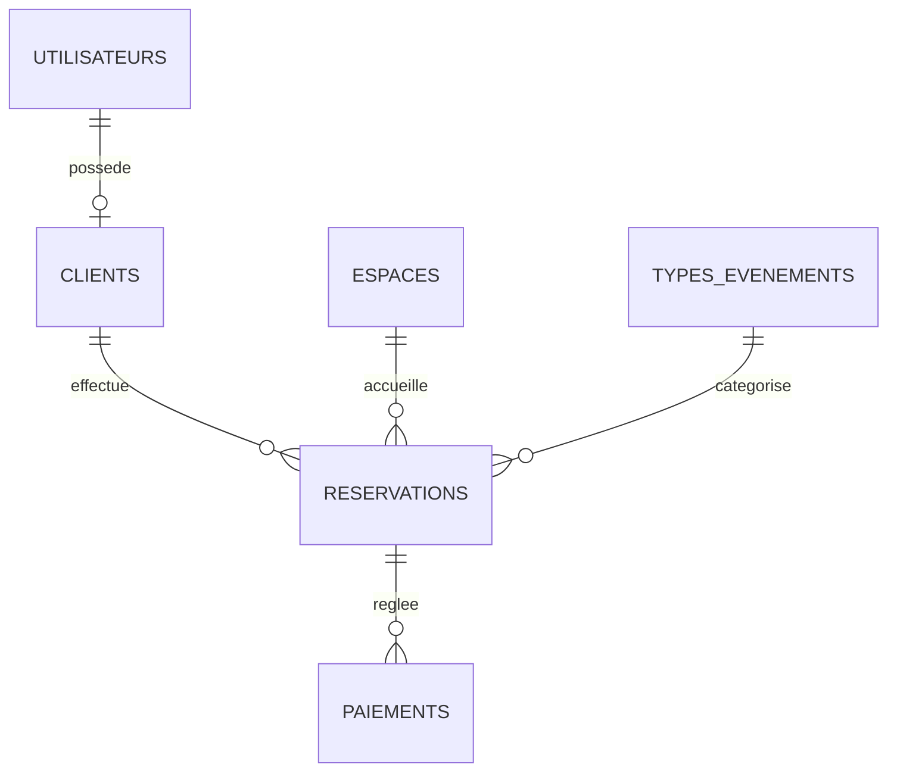

# Modèle conceptuel — Espace événementiel

- Un compte utilisateur peut être associé à un profil client.
- Un client peut réserver plusieurs espaces à des dates différentes.
- Un espace ne peut pas accueillir deux réservations qui se chevauchent.
- La capacité de l’espace doit couvrir le nombre d’invités.
- Chaque réservation porte sur un seul espace et un seul type d’événement.
- Une réservation peut recevoir plusieurs paiements.
- Les catégories proposées par défaut sont le mariage, l’anniversaire et la conférence, la soutenance.
